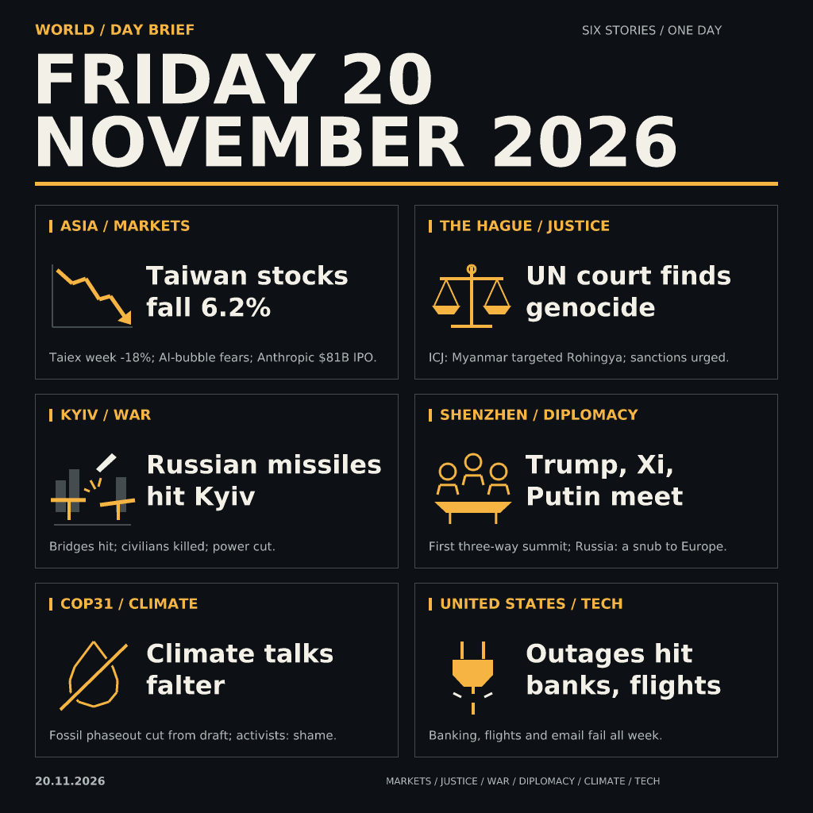

# World / Day Brief

A code-drawn news poster for Friday 20 November 2026: six stories, six beats,
one amber accent on a flat near-black ground. The date is the largest type.

<!-- Competition badge metadata; explicit canonical destinations.

-->

## Run

    mkdir -p out
    MAKEFUN_OUTPUT_DIR=out node main.ts

Node 22.18 or newer. The default destination is `/output/entry.png`.
The entrypoint creates the destination directory, draws the poster from scratch,
and writes one complete 1024 by 1024 RGB PNG. It never copies the committed
image as a substitute for rendering. No network, npm installation, Python,
Pillow, browser, canvas, clock, randomness, or external artwork is used at runtime.

The only font inputs are the system DejaVu Sans Regular and Bold TrueType files
in `/usr/share/fonts/truetype/dejavu/`. The original renderer reads their Unicode
maps, metrics and outlines, expands quadratic curves, fills paths with the
non-zero winding rule at 3x resolution, and area-downsamples the raster.
PNG chunks, CRC32 checksums and scanlines are authored here; compression uses
Node's built-in zlib. There is no third-party rendering library.

## Stories

The editorial brief supplies the stories; this is an illustration of that supplied
content, not an independently researched news report.

- ASIA / MARKETS: Taiwan stocks fall 6.2%; the Taiex's weekly decline and AI fears.
- THE HAGUE / JUSTICE: the ICJ's Myanmar genocide finding concerning the Rohingya.
- KYIV / WAR: Russian strikes, damaged bridges, civilian deaths and power cuts.
- SHENZHEN / DIPLOMACY: the first Trump-Xi-Putin three-way summit.
- COP31 / CLIMATE: fossil-fuel phaseout dropped from the negotiating draft.
- UNITED STATES / TECH: banking, air travel and email failures during the week.

## Reproduce and verify

    MAKEFUN_OUTPUT_DIR=. node main.ts
    node verify.mjs

The verifier launches two independent generator processes into `out/run-a` and
`out/run-b`, enforces a 60-second timeout per run, compares every PNG byte,
and checks that the committed `entry.png` matches. It independently validates
PNG framing, every chunk checksum, decompressed scanline length, dimensions,
the 1 MiB cap and nonblank pixel coverage.

It also checks all six exact headlines, maximum headline word count, largest-date
hierarchy, headline and detail font minima, actual glyph bounds, text collisions,
tile containment, icon clearance, and light/accent pixel coverage in every tile.
A repository scan excludes git internals and permits explicit network URLs only
in README HTML comments. Rendering itself makes no network calls.

For the requested small-image inspection:

    MAKEFUN_OUTPUT_DIR=out MAKEFUN_QA=1 node main.ts

This additionally writes `out/preview.png` at 350 by 350 and `out/layout.json`
with measured text and actual outline bounds. The verifier inspects preview
pixel coverage and byte identity. `preview.png` is a committed copy for convenient
inspection; the full-resolution entry remains the sole judged image.

## Scope and license

MIT licensed; the starter's license and ownership metadata are preserved.
All renderer and verification code was written for this entry. No other entry,
photography, remote assets, icon fonts, or generated-image service was used.
Session recording and competition submission are deliberately outside this task.
